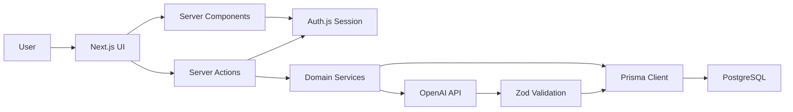
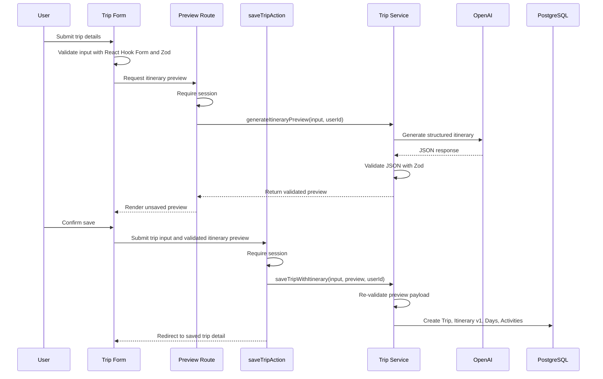

# AI Trip Planner Technical Design

## 1. Project Summary

AI Trip Planner is a full-stack web application that helps authenticated users create, preview, save, revisit, and regenerate personalized travel itineraries. Users provide trip constraints such as destination, travel dates, budget, interests, and travel style. The application generates a structured day-by-day itinerary using the OpenAI API, validates the result, lets the user preview it, and persists confirmed itineraries in PostgreSQL.

This project is optimized for SWE internship portfolio value. The MVP should demonstrate production-style full-stack engineering: clean architecture, normalized data modeling, authentication, secure API integration, structured AI generation, form validation, server-side data access, and user-friendly frontend states.

## 2. Goals and Non-Goals

### Goals

- Build a modern full-stack app using Next.js 15, TypeScript, Tailwind CSS, shadcn/ui, Prisma, PostgreSQL, Auth.js, and OpenAI.
- Support authenticated trip creation, AI itinerary generation, saved trip dashboards, trip detail pages, deletion, and regeneration.
- Store itinerary data in normalized tables rather than raw unstructured text.
- Use structured AI output validated at runtime before persistence.
- Let users preview generated itineraries before saving them.
- Keep business logic out of UI components.
- Demonstrate maintainable architecture suitable for technical interviews.

### Non-Goals for MVP

- Real-time flight, hotel, booking, or map integrations.
- Payments or monetization.
- Collaborative trip planning.
- Live availability checking.
- Complex preference learning or recommendation ranking beyond explicit user inputs.
- Native mobile support.

These are deliberately deferred because they add integration weight before the core full-stack architecture is proven.

## 3. Product Scope

### MVP Features

- User authentication:
  - Sign up
  - Sign in
  - Sign out
  - Protected dashboard and trip detail routes

- Trip creation:
  - Destination
  - Start date
  - End date
  - Budget
  - Interests
  - Travel style

- AI itinerary generation:
  - Generates one itinerary per trip request
  - Produces structured JSON
  - Shows a preview before saving to the database
  - Includes morning, afternoon, and evening activities for each trip day
  - Each activity includes name, description, estimated cost, recommendation reason, category, and time block

- Trip dashboard:
  - View saved trips
  - Open trip detail pages
  - Delete trips
  - Regenerate itinerary for an existing trip

### Phase 2 Features

- User preferences:
  - Preferred budget range
  - Favorite travel styles
  - Favorite activity categories

- Dynamic replanning:
  - Replace individual activities
  - Regenerate individual days
  - Request cheaper, outdoor, indoor, family-friendly, or lower-effort alternatives

- Cost analysis:
  - Daily estimated spending
  - Total estimated trip cost
  - Budget utilization summary

## 4. Recommended Tech Stack

### Frontend

- Next.js 15 App Router
- React Server Components where appropriate
- Client Components only for interactive forms, optimistic UI, and local state
- TypeScript with strict mode
- Tailwind CSS
- shadcn/ui
- React Hook Form
- Zod
- `@hookform/resolvers` for connecting React Hook Form and Zod

### Backend

- Next.js Server Actions for form-driven mutations
- Route Handlers for AI generation and JSON-style API endpoints when explicit HTTP boundaries are useful
- Prisma ORM
- PostgreSQL

### Authentication

- Auth.js / NextAuth
- Prisma adapter
- GitHub OAuth
- Google OAuth

Email/password is intentionally excluded from the MVP. OAuth avoids password storage complexity while still demonstrating protected user data, session-aware server code, and real production authentication flows.

### AI

- OpenAI API
- Structured output using JSON schema
- Runtime validation with Zod before saving

### Deployment

- Vercel
- Neon PostgreSQL
- Environment variables managed in Vercel project settings

## 5. System Architecture



### Architectural Principles

- UI components render state and call actions; they do not contain business rules.
- Server Actions handle authenticated mutations and delegate complex operations to services.
- Services contain core application workflows, such as creating trips and generating itineraries.
- Prisma is accessed through a shared database client.
- AI responses are never trusted directly. They must pass schema validation before rendering or persistence.
- Authorization is checked server-side for every trip-specific read and write.

## 6. Folder Structure

```text
app/
  (auth)/
    sign-in/
      page.tsx
  (dashboard)/
    dashboard/
      page.tsx
    trips/
      new/
        page.tsx
      [tripId]/
        page.tsx
  api/
    auth/
      [...nextauth]/
        route.ts
    trips/
      preview/
        route.ts
      [tripId]/
        regenerate/
          route.ts
  layout.tsx
  page.tsx

components/
  auth/
    sign-in-button.tsx
    user-menu.tsx
  trips/
    trip-form.tsx
    itinerary-preview.tsx
    trip-card.tsx
    trip-list.tsx
    itinerary-day-card.tsx
    activity-card.tsx
    delete-trip-button.tsx
    regenerate-itinerary-button.tsx
  ui/
    shadcn components

lib/
  actions/
    trip-actions.ts
  ai/
    itinerary-generator.ts
    itinerary-prompts.ts
    itinerary-schema.ts
    itinerary-parser.ts
  auth/
    auth-options.ts
    require-user.ts
  db/
    prisma.ts
  services/
    trip-service.ts
    itinerary-service.ts
    itinerary-preview-service.ts
  validation/
    trip-input.ts
  utils/
    dates.ts
    money.ts

prisma/
  schema.prisma
  migrations/

types/
  itinerary.ts

docs/
  TECHNICAL_DESIGN.md
```

### Notes

- `app/` owns routing and page composition.
- `components/` owns reusable UI.
- `lib/actions/` owns Server Actions.
- `lib/services/` owns business workflows.
- `lib/ai/` owns AI prompt construction, schema definitions, and OpenAI integration.
- `lib/validation/` owns user input schemas.
- `types/` is reserved for shared TypeScript types that are not better inferred from Zod or Prisma.

## 7. Database Design

### Entity Overview

- `User`: authenticated account owner
- `Account`, `Session`, `VerificationToken`: Auth.js adapter tables
- `Trip`: user-created travel plan request
- `Itinerary`: generated itinerary for a trip
- `ItineraryDay`: one day in an itinerary
- `Activity`: morning, afternoon, or evening recommendation
- `UserPreferences`: optional user-level personalization data

### Prisma Schema Draft

```prisma
model User {
  id              String           @id @default(cuid())
  name            String?
  email           String?          @unique
  emailVerified   DateTime?
  image           String?
  accounts        Account[]
  sessions        Session[]
  trips           Trip[]
  preferences     UserPreferences?
  createdAt       DateTime         @default(now())
  updatedAt       DateTime         @updatedAt
}

model Trip {
  id            String       @id @default(cuid())
  userId        String
  user          User         @relation(fields: [userId], references: [id], onDelete: Cascade)
  destination   String
  startDate     DateTime
  endDate       DateTime
  budgetCents   Int
  currency      String       @default("USD")
  interests     String[]
  travelStyle   TravelStyle
  itineraries   Itinerary[]
  createdAt     DateTime     @default(now())
  updatedAt     DateTime     @updatedAt

  @@index([userId])
  @@index([destination])
}

model Itinerary {
  id                    String          @id @default(cuid())
  tripId                String
  trip                  Trip            @relation(fields: [tripId], references: [id], onDelete: Cascade)
  version               Int
  generationPromptHash  String?
  model                 String
  totalEstimatedCostCents Int?
  days                  ItineraryDay[]
  createdAt             DateTime        @default(now())

  @@unique([tripId, version])
  @@index([tripId])
}

model ItineraryDay {
  id                      String      @id @default(cuid())
  itineraryId             String
  itinerary               Itinerary   @relation(fields: [itineraryId], references: [id], onDelete: Cascade)
  dayNumber               Int
  date                    DateTime
  summary                 String?
  estimatedCostCents      Int?
  activities              Activity[]

  @@unique([itineraryId, dayNumber])
  @@index([itineraryId])
}

model Activity {
  id                      String        @id @default(cuid())
  itineraryDayId          String
  itineraryDay            ItineraryDay  @relation(fields: [itineraryDayId], references: [id], onDelete: Cascade)
  timeBlock               TimeBlock
  name                    String
  description             String
  estimatedCostCents      Int
  reason                  String
  category                String
  locationHint            String?
  sortOrder               Int

  @@index([itineraryDayId])
}

model UserPreferences {
  id                    String        @id @default(cuid())
  userId                String        @unique
  user                  User          @relation(fields: [userId], references: [id], onDelete: Cascade)
  preferredBudgetMinCents Int?
  preferredBudgetMaxCents Int?
  favoriteTravelStyles TravelStyle[]
  favoriteCategories   String[]
  createdAt             DateTime      @default(now())
  updatedAt             DateTime      @updatedAt
}

enum TravelStyle {
  RELAXED
  ADVENTURE
  CULTURE
  FOODIE
  NIGHTLIFE
  FAMILY
  LUXURY
  BUDGET
}

enum TimeBlock {
  MORNING
  AFTERNOON
  EVENING
}
```

Auth.js adapter models will also be included in the final Prisma schema: `Account`, `Session`, and `VerificationToken`.

### Design Decisions

- `Trip` stores the user's original request.
- `Itinerary` is versioned so regeneration preserves history and gives a strong interview talking point around auditability.
- Generated previews are not persisted. A `Trip` and its first `Itinerary` are created only after the user confirms the preview.
- Regenerated previews for existing trips are also transient. Confirming the preview creates the next `Itinerary.version`.
- `ItineraryDay` and `Activity` are normalized so the app can support day-level regeneration and activity replacement later.
- `budgetCents` and `estimatedCostCents` avoid floating-point money bugs.
- `TravelStyle` and `TimeBlock` use enums to prevent invalid states.
- `interests` stays as a string array in MVP for flexibility. If categories become curated and searchable later, it can be normalized into a separate table.

## 8. Authentication and Authorization

### Authentication Flow

1. User signs in with GitHub or Google OAuth.
2. Auth.js creates or retrieves the `User`.
3. Session is available to Server Components, Server Actions, and Route Handlers.
4. Protected routes redirect unauthenticated users to sign-in.

### Authorization Rules

- A user can only read trips where `trip.userId === session.user.id`.
- A user can only regenerate or delete their own trips.
- All trip mutations must call a shared `requireUser()` helper.
- Never trust `userId` from the client.

## 9. API and Server Action Flow

### Trip Preview and Save Flow



The preview is intentionally transient. If the user refreshes before saving, they can regenerate the preview. This keeps the database limited to user-confirmed trips and avoids storing unwanted AI outputs.

### Dashboard Flow

1. Server Component calls `getTripsForCurrentUser()`.
2. Service queries trips by authenticated user ID.
3. Dashboard renders trip cards.
4. Empty state prompts user to create a new trip.

### Trip Detail Flow

1. Page receives `tripId`.
2. Server Component calls `getTripDetailForCurrentUser(tripId)`.
3. Service verifies ownership through the database query.
4. Page renders latest itinerary version by default.

### Delete Trip Flow

1. User clicks delete.
2. Server Action calls `deleteTripAction(tripId)`.
3. Service deletes only if the trip belongs to the current user.
4. Cascade delete removes itinerary days and activities.
5. UI refreshes dashboard.

### Regenerate Flow

1. User clicks regenerate on a saved trip.
2. Route Handler verifies ownership.
3. Service generates a transient itinerary preview using the original trip inputs.
4. UI displays the regenerated preview without overwriting the current itinerary.
5. User confirms the regenerated preview.
6. Server Action revalidates the payload and creates the next `Itinerary.version`.
7. Trip detail displays the newest saved version by default while preserving older versions.

## 10. AI Generation Design

### Prompt Strategy

The AI request should include:

- Destination
- Start and end dates
- Number of days
- Budget and currency
- Interests
- Travel style
- Required response schema
- Safety instruction to avoid invented exact reservations, live availability, or guaranteed prices

### Structured Output Shape

```ts
type GeneratedItinerary = {
  days: Array<{
    dayNumber: number;
    date: string;
    summary: string;
    estimatedCostCents: number;
    activities: Array<{
      timeBlock: "MORNING" | "AFTERNOON" | "EVENING";
      name: string;
      description: string;
      estimatedCostCents: number;
      reason: string;
      category: string;
      locationHint?: string;
      sortOrder: number;
    }>;
  }>;
  totalEstimatedCostCents: number;
};
```

### Validation

The app should validate:

- Number of days equals trip date range.
- Each day has exactly three activities.
- Time blocks are morning, afternoon, and evening.
- Estimated costs are non-negative integers.
- Total estimated cost is consistent with daily totals within a small tolerance.
- Text fields are non-empty and length-limited.

### Failure Handling

- If AI generation fails during preview, do not persist a trip.
- Do not save invalid AI output.
- Show a clear retry option.
- Log enough metadata for debugging without storing sensitive prompts unnecessarily.

## 11. Validation Rules

Trip forms should use React Hook Form with Zod schemas through `@hookform/resolvers`. The same Zod schemas should be reused server-side where practical so client-side feedback and server-side enforcement stay aligned.

### Trip Input

- Destination:
  - Required
  - Minimum 2 characters
  - Maximum 100 characters

- Dates:
  - Start date required
  - End date required
  - End date must be on or after start date
  - MVP maximum trip length: 14 days

- Budget:
  - Required
  - Positive number
  - Stored in cents

- Interests:
  - At least one interest
  - Maximum 8 interests

- Travel style:
  - Must be one supported enum value

### Why Cap Trip Length?

Limiting MVP trips to 14 days improves cost control, AI reliability, database predictability, and UI readability. This is a practical production-minded constraint and a good interview discussion point.

## 12. UI and UX Design

### Routes

- `/`: Public landing or redirect based on auth state
- `/sign-in`: Authentication page
- `/dashboard`: Saved trips
- `/trips/new`: Trip creation form
- `/trips/[tripId]`: Trip detail and itinerary

### Key UX States

- Loading state during generation
- Empty dashboard state
- Form validation errors
- AI generation failure state
- Delete confirmation
- Regeneration pending state
- Protected route redirects

### Component Strategy

- Keep form components client-side.
- Keep data fetching in Server Components.
- Use small reusable itinerary components.
- Use shadcn/ui for consistent input, button, card, dropdown, badge, alert, dialog, and skeleton components.

## 13. Security Considerations

- Store OpenAI API key only in server environment variables.
- Never expose AI calls directly from client components.
- Validate all user input with Zod.
- Authorize every trip read and write by session user ID.
- Avoid storing raw provider tokens unless needed.
- Use Prisma parameterized queries by default.
- Add rate limiting later for generation endpoints if abuse becomes a concern.

## 14. Error Handling and Observability

### Error Handling

- Server Actions return typed error states for form failures.
- Route Handlers return structured JSON errors.
- Services throw domain-specific errors where useful.
- UI displays user-friendly messages and avoids exposing internal details.

### Logging

For MVP, log:

- AI generation failures
- Validation failures from AI output
- Unexpected service errors

Avoid logging:

- Full OAuth tokens
- Raw session secrets
- Large raw AI outputs in production logs

## 15. Testing Strategy

### MVP Testing

Use Vitest for unit tests. Add React Testing Library once component interaction tests become useful.

- Unit tests:
  - Date range utilities
  - Money conversion utilities
  - Zod validation schemas
  - AI response parser
  - Trip length enforcement
  - Itinerary version calculation
  - Preview payload validation before persistence

- Integration tests:
  - Trip creation service with mocked OpenAI response
  - Ownership checks for trip access
  - Itinerary persistence shape
  - Regeneration creates a new version rather than overwriting the previous itinerary

- Manual QA:
  - Sign in and sign out
  - Generate itinerary preview
  - Save confirmed itinerary
  - View dashboard
  - Delete trip
  - Regenerate itinerary preview
  - Confirm regenerated itinerary as a new version

### Optional Later Testing

- Playwright end-to-end tests for core flows
- Mock Service Worker for AI endpoint behavior
- Snapshot-style tests for AI schema validation fixtures

## 16. Environment Variables

```text
DATABASE_URL=
AUTH_SECRET=
AUTH_GITHUB_ID=
AUTH_GITHUB_SECRET=
AUTH_GOOGLE_ID=
AUTH_GOOGLE_SECRET=
OPENAI_API_KEY=
```

## 17. Deployment Plan

1. Create Vercel project.
2. Provision Neon PostgreSQL.
3. Add environment variables.
4. Run Prisma migrations.
5. Configure OAuth callback URLs.
6. Deploy.
7. Validate auth, trip creation, AI generation, and persistence in production.

## 18. Phased Implementation Roadmap

### Phase 0: Project Scaffolding

- Create Next.js 15 TypeScript app.
- Configure Tailwind CSS.
- Install and initialize shadcn/ui.
- Add ESLint, Prettier, and strict TypeScript settings.
- Add base layout, theme, and shared UI primitives.

Deliverable: Clean app shell with linting and formatting.

### Phase 1: Database and Auth

- Install Prisma.
- Define initial schema with Auth.js adapter models and trip entities.
- Create Neon PostgreSQL database.
- Run first migration.
- Configure Auth.js with GitHub and Google OAuth.
- Add protected route helper.

Deliverable: Users can sign in and access protected dashboard.

### Phase 2: Trip Creation Without AI

- Build trip creation form.
- Add React Hook Form with Zod validation.
- Add Server Action for saving a confirmed trip.
- Add dashboard list.
- Add trip detail page shell.

Deliverable: Authenticated users can save and view confirmed trip records.

### Phase 3: AI Itinerary Generation

- Add OpenAI integration.
- Define structured output schema.
- Validate AI result with Zod.
- Add itinerary preview route.
- Add preview UI before persistence.
- Persist itinerary, days, and activities only after user confirmation.
- Add loading and failure states.

Deliverable: Users can generate, preview, and save structured itineraries.

### Phase 4: Dashboard Management

- Add delete trip flow.
- Add regenerate itinerary preview flow.
- Save confirmed regenerations as new itinerary versions.
- Display newest itinerary version.
- Add empty, loading, and error states.

Deliverable: Full MVP CRUD-style trip workflow.

### Phase 5: Portfolio Polish

- Improve UI layout and responsiveness.
- Add cost summaries.
- Add README with architecture, screenshots, setup, and demo.
- Add Vitest unit tests for validation, utilities, AI parsing, and itinerary versioning.
- Deploy to Vercel.

Deliverable: Resume-ready MVP.

### Phase 6: Phase 2 Enhancements

- Add user preferences.
- Add day-level regeneration.
- Add activity replacement.
- Add budget utilization analysis.
- Add richer testing and monitoring.

Deliverable: Stronger interview discussion around personalization and iterative AI workflows.

## 19. Recommended First Implementation Decision

Start with GitHub and Google OAuth, Neon PostgreSQL, Prisma, and a normalized itinerary schema from day one. Avoid building a temporary local-storage version because it creates throwaway work and weakens the portfolio signal. The project should immediately demonstrate authenticated, persisted, server-side full-stack behavior while still allowing generated itineraries to be previewed before saving.

## 20. Reviewed Decisions

- OAuth providers: GitHub and Google.
- Database provider: Neon PostgreSQL with Prisma.
- Generation flow: preview before saving.
- MVP trip length limit: 14 days.
- Future flexibility: keep date-range validation centralized so the limit can be increased later.
- Itinerary history: preserve versions; regenerations create new versions.
- Forms and validation: React Hook Form with Zod.
- Testing: include unit tests for core business logic in the MVP.
